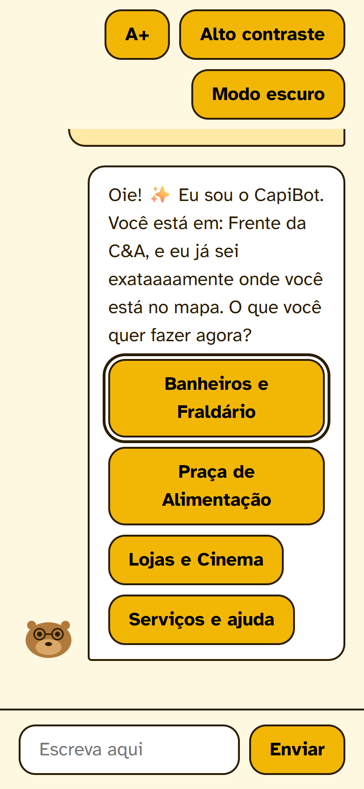
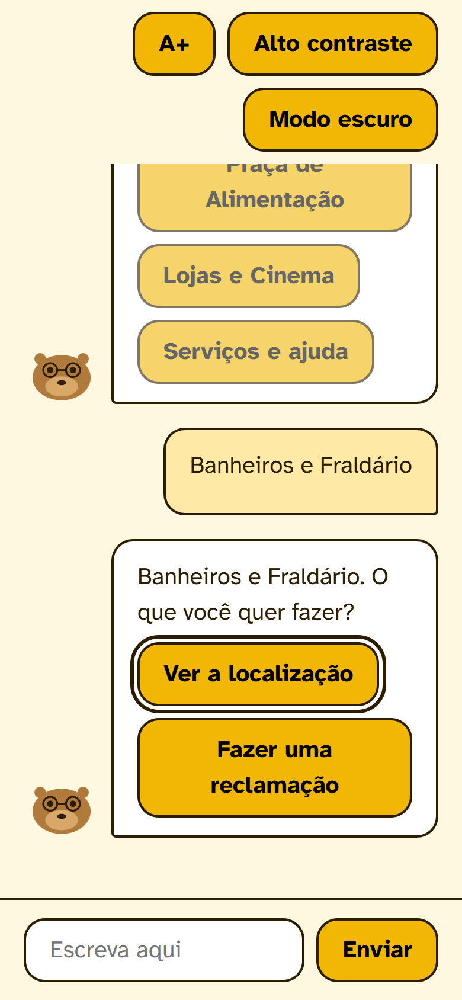
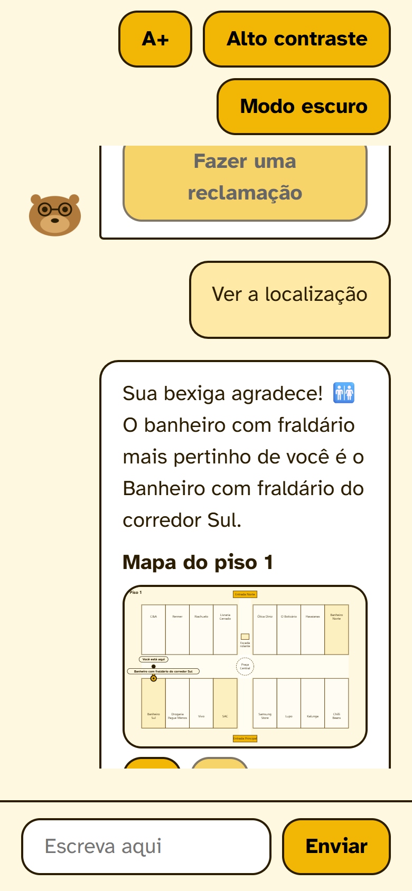
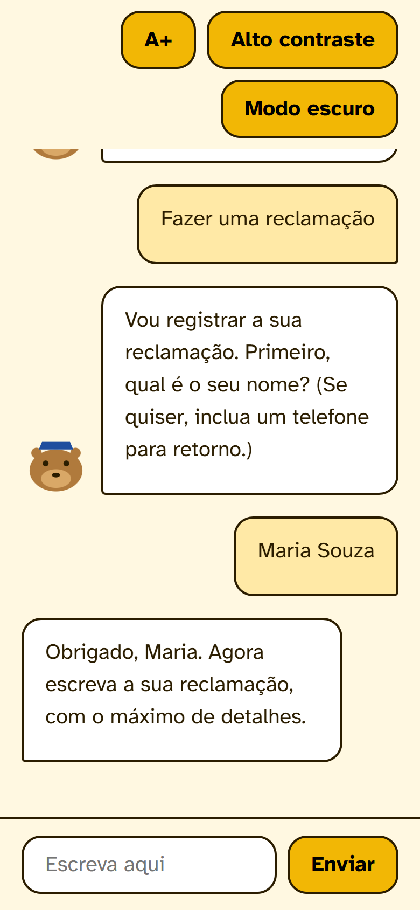
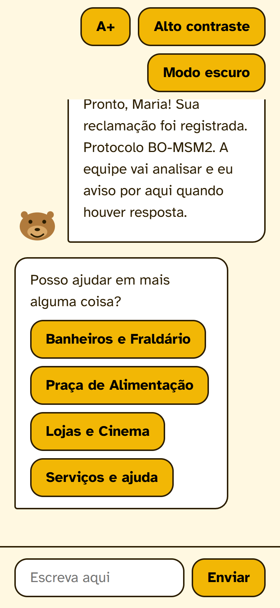
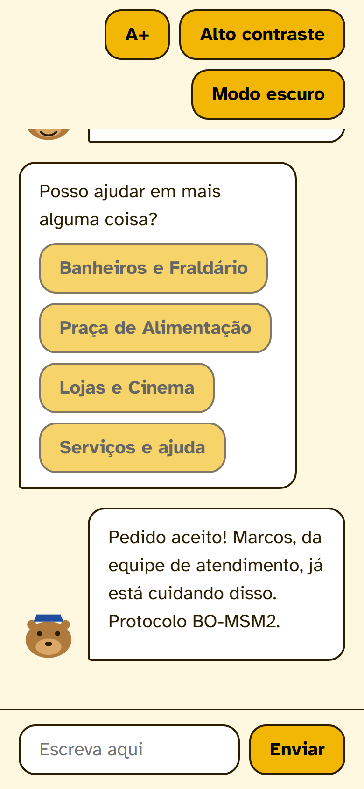
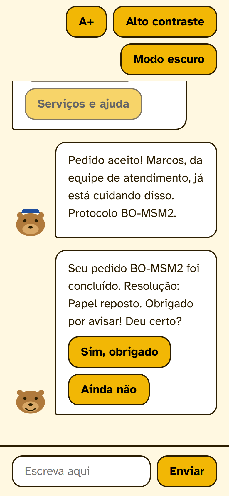

# Fluxo do chat

## Passo a passo

1. **Saudação** com 4 botões: Banheiros e Fraldário, Praça de Alimentação, Lojas e Cinema, Serviços e ajuda.
2. **Escolha:** "O que você quer fazer?" com **Ver a localização** e **Fazer uma reclamação**.
3. **Localização:**

| Tópico | Resultado |
|---|---|
| Banheiros | Mapa até o banheiro mais próximo |
| Praça | Mapa até a praça de alimentação |
| Lojas | Pede o nome (autocompletar) e mostra a rota |
| Serviços | Mapa até o SAC |

4. **Reclamação:** pede o **nome** (mínimo 2 caracteres; telefone opcional junto) e depois o **texto**. Cria o chamado e devolve o protocolo.
5. **Acompanhamento** (consulta a cada 5 s): aceito → "Fulano… está cuidando"; recusado → mostra o motivo; concluído → "Deu certo?" com **Sim, obrigado** / **Ainda não** e nota de 1 a 5.

Ao fim de cada assunto, os 4 botões iniciais voltam. Não há "Falar com uma pessoa" nem avisos dinâmicos.

| Início | Escolha | Localização |
|---|---|---|
|  |  |  |

| Texto | Protocolo | Aceito | Concluído |
|---|---|---|---|
|  |  |  |  |

## Texto livre

- Palavras como *banheiro*, *comer/praça* e *perdi/roubo/emergência* levam ao passo 2 do tópico correspondente.
- Sem atalho, responde o Gemini (ou um fallback local por palavras-chave) com **Ajudou / Não ajudou**.
- "Não ajudou" e a **2ª resposta sem solução seguida** oferecem **Fazer uma reclamação**.

## Estados (`sessions.state`)

| Estado | Significado |
|---|---|
| `inicio` | Depois da saudação |
| `aguardando_loja` | Próxima mensagem é nome de loja |
| `livre` | Resposta concluída |
| `livre_sem_resposta` | 1ª resposta da IA sem solução |
| `rec_nome\|<tópico>` | Esperando o nome |
| `rec_texto\|<tópico>\|<nome>` | Esperando o texto da reclamação |

Nos estados `rec_*` o texto digitado não passa por intenção nem IA. Clicar num botão principal sai do fluxo.

## Ids das respostas rápidas

`banheiros`, `alimentacao`, `lojas`, `servicos` · `loc:<tópico>` · `rec:<tópico>` · `store:<id>` · `ajudou`, `nao-ajudou`.
`fb-sim:<BO>`, `fb-nao:<BO>` e `rate-<n>:<BO>` são tratados no cliente (`src/lib/client/ticketMessages.ts`).

## Mapeamento da reclamação

| Tópico | Categoria do chamado |
|---|---|
| Banheiros | `banheiro` |
| Serviços | `reclamacao` |
| Praça, Lojas | `outro` |

Sempre `kind = reclamacao`. O nome vai em `contact` como `Nome: <texto>`.

Código: `src/server/orchestrator/` (`index.ts`, `handlers/servicos.ts`, `handlers/freeText.ts`) e `src/components/chat/ChatScreen.tsx`.
