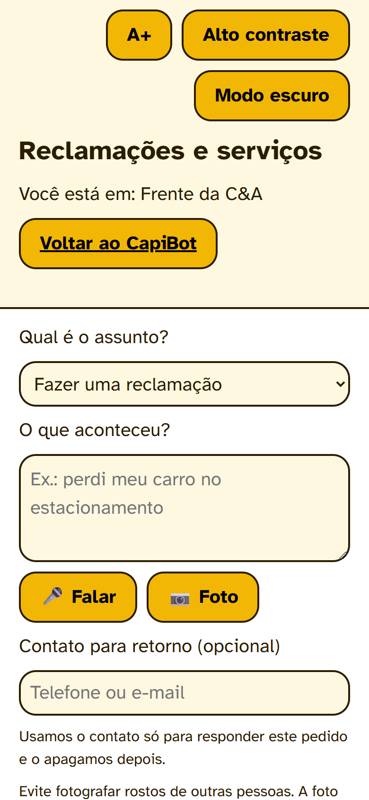
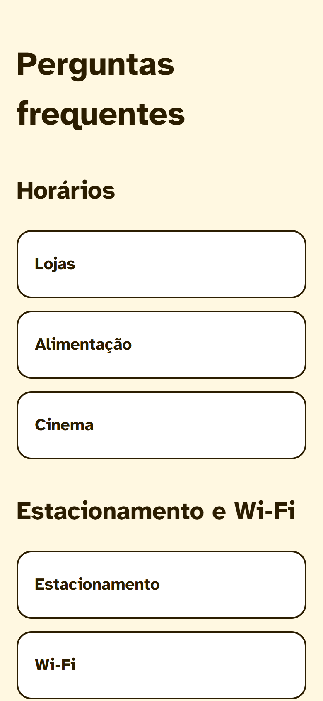

# Operação

## Rodar

```bash
npm install
cp .env.example .env.local     # GEMINI_API_KEY é opcional
npm run dev                    # http://localhost:3000
```

| Comando | Para quê |
|---|---|
| `npm test` | Testes (41) |
| `npm run validate:base` | Valida base, plantas e rotas |
| `npm run seed:demo` | Chamados fictícios para os indicadores (`-- --clear` remove) |
| `npm run https:proxy` | `https://localhost:3443` → `:3000`, para microfone e câmera no celular |
| `npm run purge:uploads` | Apaga fotos e contatos de chamados concluídos há mais de 24 h |
| `npm run gen:qr` | QR codes dos totens |
| `npm run smoke`, `npm run smoke:tickets` | Smoke via PowerShell (servidor ligado) |

## Variáveis

| Variável | Uso |
|---|---|
| `GEMINI_API_KEY`, `GEMINI_MODEL` | IA para perguntas livres (sem chave usa o fallback local) |
| `BASE_URL` | URL dos QR codes |
| `NEXT_PUBLIC_USE_MOCKS` | `true` usa respostas simuladas **sem** este fluxo; use `false` |
| `CAPIBOT_DB`, `UPLOADS_DIR` | Caminhos do banco e das fotos |
| `NEXT_DIST_DIR` | Pasta de build, para uma 2ª instância |

`PANEL_PASSWORD` e `SESSION_SECRET` não são mais usadas. Variáveis `NEXT_PUBLIC_` só valem depois de reiniciar o `next dev`.

## Segurança e LGPD

- **Painel, métricas e fotos estão abertos** a quem tiver a URL: nome, telefone, texto e fotos dos chamados ficam expostos, e qualquer pessoa pode aceitar, recusar ou concluir. Antes de publicar, restrinja por rede ou proxy.
- O visitante só lê os chamados da própria sessão (`404` caso contrário).
- Fotos validadas pelo conteúdo do arquivo, não só pelo tipo informado.
- `npm run purge:uploads` cobre fotos e contatos.

## Testes

Vitest em `src/server/__tests__/`: categorização, transições, conclusão, avaliação, reabertura, escalonamento, recusa sem vazar contato, indicadores e o orquestrador (incluindo o fluxo completo de reclamação).

Verificado no navegador (Edge, janelas de celular e desktop): chat, painel, indicadores, `/atendimento` e `/faq`. **Não verificado:** celular físico, microfone e câmera, TalkBack e Lighthouse.

## Limitações conhecidas

- Reabrir zera o horário de aceite; "tempo até aceitar" e "no prazo" ignoram os reabertos.
- Um chamado recusado pode ser reaberto pela API (o chat não oferece o botão).
- A reclamação no chat é só texto; foto e voz existem apenas em `/atendimento`.
- `/atendimento` e os links dela no `/faq` ficaram fora da simplificação do chat.
- Nota e transferência não têm botão no painel.
- Pouca memória derruba um 2º `next dev`; use uma instância só.

## Capturas

 
