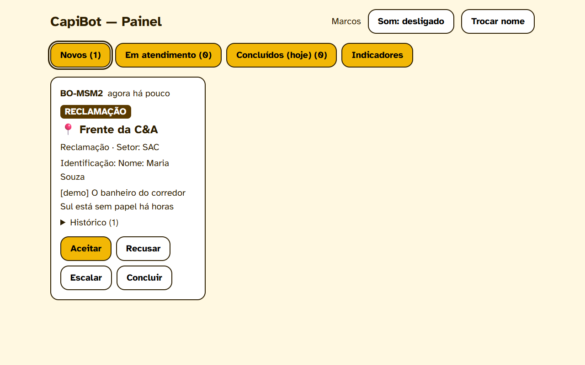
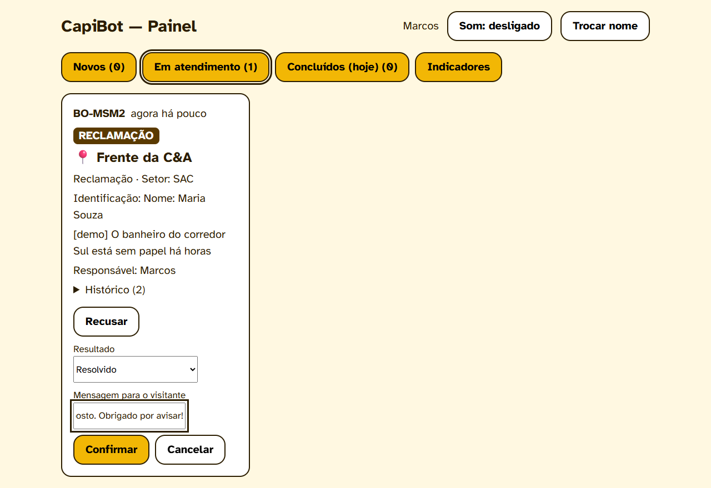
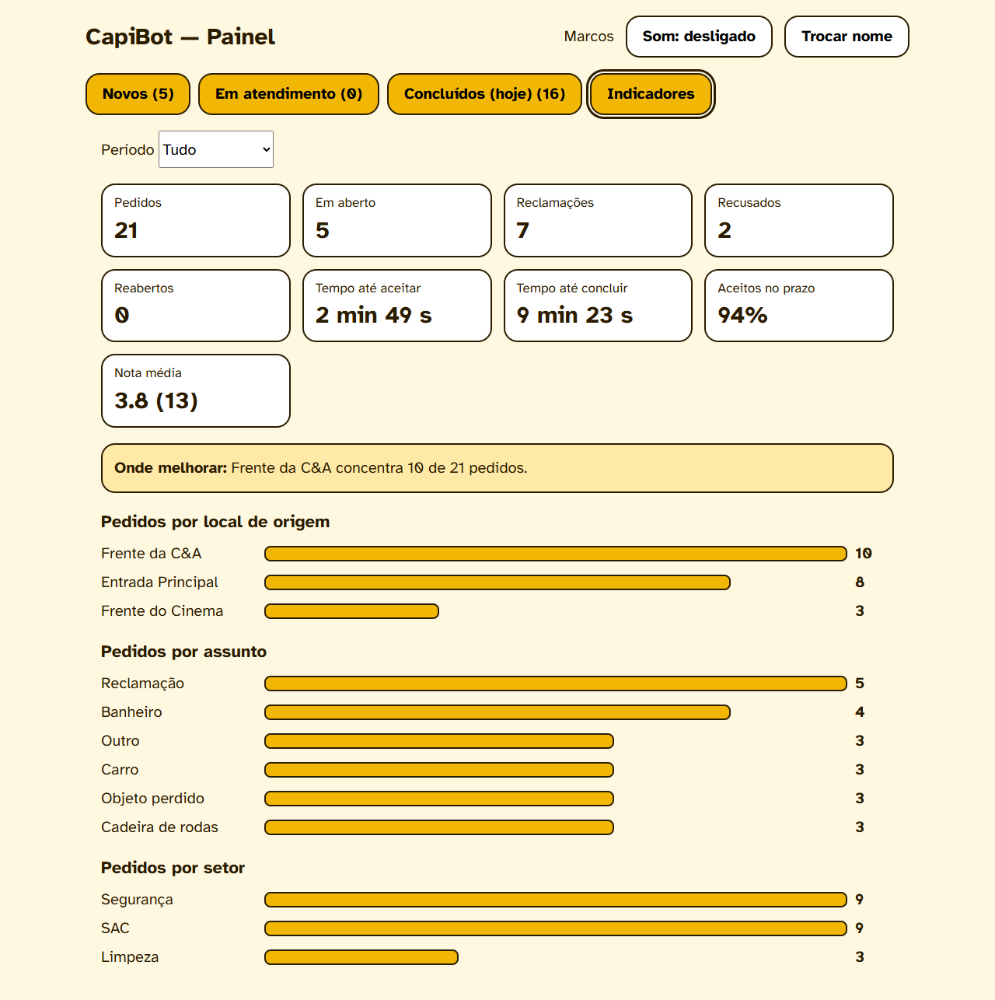

# Painel da equipe

Rota `/painel`. **Sem senha**: pede só o nome (guardado no navegador), que o visitante vê ao ser atendido. "Trocar nome" fica no topo. Atualiza a cada 4 s.

## Abas

Novos · Em atendimento · Concluídos (hoje) · Indicadores.

## Cartão do chamado

Protocolo, tempo, local de origem, assunto, setor, identificação, texto, foto, responsável e histórico. Selos: **ALTA**, **ATRASADO**, **RECLAMAÇÃO**.

## Ações

| Ação | Efeito |
|---|---|
| Aceitar | `novo` → `assumido`. Se outra pessoa já aceitou, mostra quem |
| Recusar | Exige motivo (mín. 3 caracteres), que o visitante vê. Grava `improcedente` |
| Escalar | Prioridade `alta` e setor Segurança |
| Concluir | Escolhe o resultado e escreve a mensagem ao visitante |
| Nota, Transferir | Só pela API (sem botão) |

Resultados ao concluir: resolvido, encaminhado, não localizado, improcedente.

## Prazos (SLA)

| Prioridade | Prazo para aceitar |
|---|---|
| Alta | 3 min |
| Normal | 5 min |

Passou do prazo e ainda `novo`: selo **ATRASADO**. Passou de 2× o prazo: escalado sozinho na próxima listagem (sem cron).

## Indicadores

Pedidos, em aberto, reclamações, recusados, reabertos, tempo médio até aceitar e até concluir, % aceitos no prazo, nota média, e barras por local, assunto e setor. O destaque "Onde melhorar" aponta o local com mais pedidos. Filtro de período: tudo, 24 h ou 7 dias.

Para popular com dados de demonstração: `npm run seed:demo` (`-- --clear` remove).

## Resolução vista pelo visitante

- **Ainda não** reabre o chamado: uma vez, até 24 h depois de concluído, só na mesma sessão. Volta como `novo`, prioridade alta.
- Nota de 1 a 5 só depois de concluído.

Código: `src/app/painel/`, `src/server/tickets/` (`service.ts`, `metrics.ts`).
