# TechSpec 05 — Ciclo de Atendimento: orientar, informar, reclamar e resolver (estado atual)

**Objetivo:** documentar o fluxo **como está implementado** para fechar o desafio "07. Atendimento e experiência de serviços": o visitante é **orientado** (mapa e rota dourada), **informado** (botões, FAQ e IA), **registra uma reclamação** (com identificação e protocolo) e acompanha a **resolução**, enquanto a equipe aceita ou recusa, conclui e mede a qualidade.

**Esta spec prevalece** sobre as TechSpecs 01–04 onde houver divergência (elas descrevem o planejamento original; veja o quadro "Status" no topo de cada uma).

**Contratos:** [README.md](README.md) e `src/types/contracts.ts`. Migrações: `001_sessions.sql`, `002_tickets.sql`, `003_atendimento.sql`.

## 1. Visão geral (3 telas)

| Tela | Rota | Quem usa | Função |
|---|---|---|---|
| 1. Chat | `/?p=<pontoId>` | Visitante | Informar e orientar (mapas) e registrar reclamação |
| 2. Reclamações e serviços | `/atendimento?p=<pontoId>` | Visitante | Formulário com assunto, texto, voz, foto e contato opcional. **Não é mais linkada pelo chat**; segue acessível por URL e pelo rodapé do `/faq` |
| 3. Painel da equipe | `/painel` | Equipe | Aceitar/recusar, concluir, acompanhar, indicadores. **Sem senha** |

Há ainda o `/faq` (página estática, sem JavaScript necessário).

| Tela 2 — `/atendimento` | `/faq` |
|---|---|
| 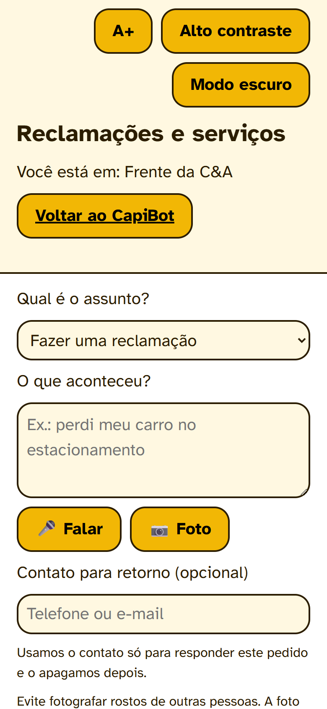 | 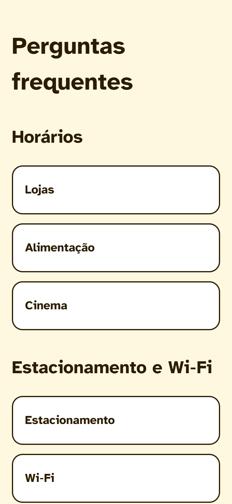 |

> Capturas feitas no celular (390 px) e no desktop (1280 px) com o app em desenvolvimento. Os chamados que aparecem têm o prefixo `[demo]` e foram removidos do banco depois.

## 2. Fluxo do chat (Tela 1)

```
QR (?p=ponto) ─► saudação + 4 botões
                    │ Banheiros e Fraldário │ Praça de Alimentação │ Lojas e Cinema │ Serviços e ajuda
                    ▼
             "O que você quer fazer?"   [Ver a localização]   [Fazer uma reclamação]
                    │                              │
        ┌───────────┴───────────┐                  ▼
        ▼                       ▼          "Qual é o seu nome?"   (≥ 2 caracteres; telefone opcional junto)
   LOCALIZAÇÃO              RECLAMAÇÃO              ▼
 banheiros → mapa até o   (ver ao lado)      "Escreva a sua reclamação"
   banheiro mais próximo                            ▼
 praça → mapa até a praça              cria chamado → "Protocolo BO-XXXX"
 lojas → pede o nome (autocompletar)              ▼
   → rota até a loja                      chat acompanha o chamado (polling 5 s)
 serviços → mapa até o SAC                         ▼
        ▼                          aceito → "Fulano… já está cuidando"
 volta aos 4 botões                recusado → "A equipe não pôde atender… Motivo: …"
                                   concluído → "Deu certo?" [Sim, obrigado] [Ainda não] → nota 1–5
```

Regras:
- **Não existe** faixa "Falar com uma pessoa" nem botão/link "Reclamações e serviços" no chat. Nenhuma resposta do bot oferece "Falar com uma pessoa" (há teste para isso).
- Depois de qualquer resposta que encerra um assunto (mapa, passos, etc.), o orquestrador anexa os 4 botões iniciais (`handleChat` em `orchestrator/index.ts`).
- **Texto livre:** atalhos por regex (`banheiro`, `comer/fome/praça`, `perdi/roubo/socorro/cadeira de rodas/carro/emergência`) levam ao passo "localização ou reclamação" do tópico. Sem atalho, vai para o Gemini (ou fallback local por palavras-chave).
- Respostas informativas trazem **Ajudou / Não ajudou**. "Não ajudou" e a **2ª resposta sem solução seguida** oferecem **Fazer uma reclamação**.
- Não há avisos dinâmicos (foram descartados).
- Tópico → categoria do chamado: `banheiros → banheiro`, `servicos → reclamacao`, `alimentacao` e `lojas → outro`. Todos entram como `kind = reclamacao`; a identificação vai em `contact` como `Nome: <texto>`.

**Capturas do fluxo** (celular, ponto `frente-cea`):

| 1. Início | 2. Escolha | 3. Localização |
|---|---|---|
| 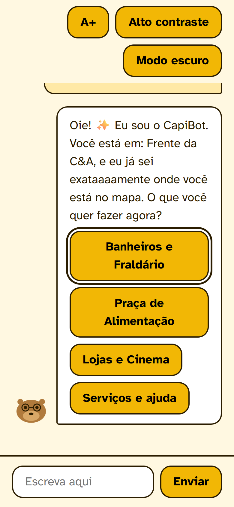 | 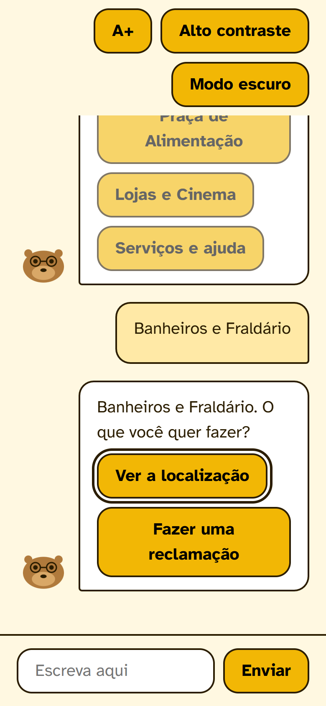 | 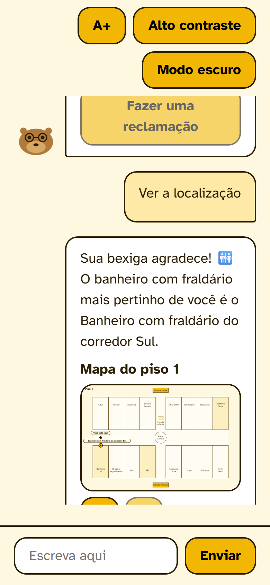 |

| 4. Texto da reclamação | 5. Protocolo | 6. Aceito pela equipe |
|---|---|---|
| 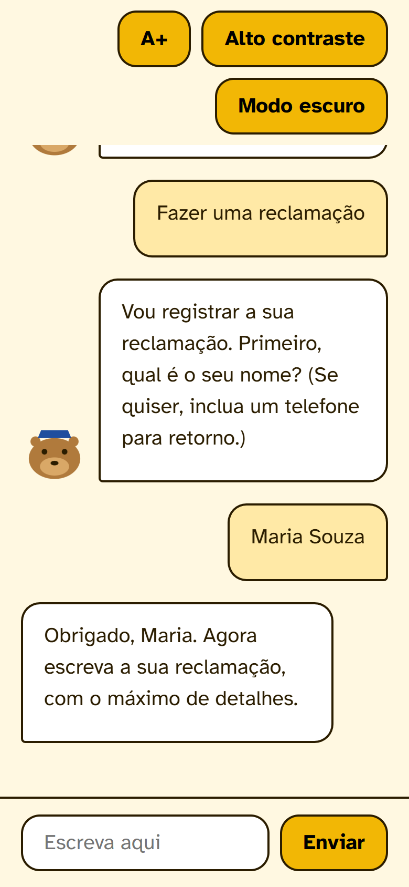 | 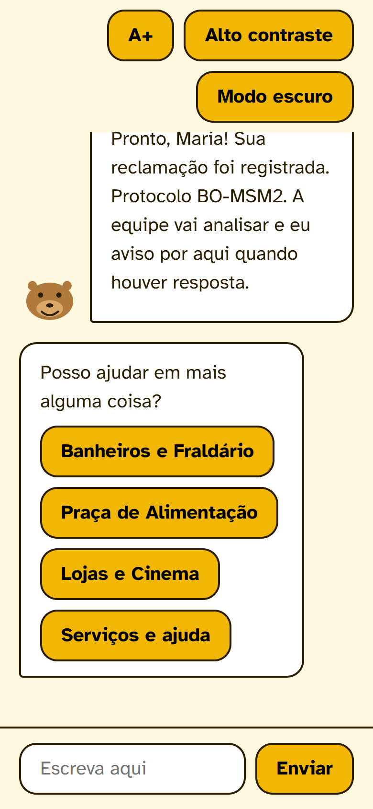 | 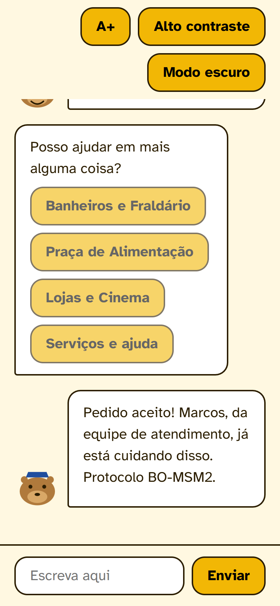 |

| 7. Concluído: "Deu certo?" |
|---|
| 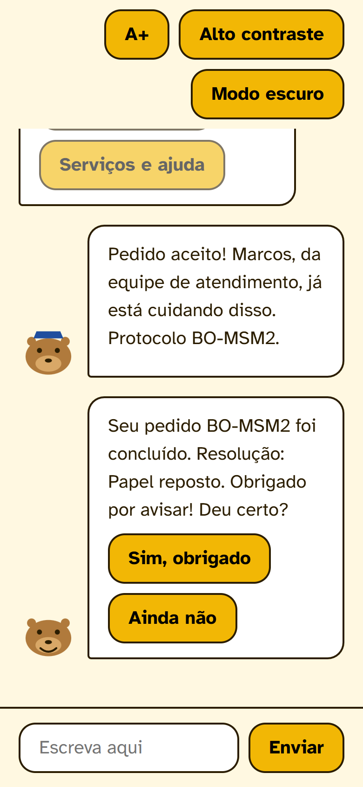 |

### Máquina de estados (`sessions.state`)

| Estado | Significado |
|---|---|
| `inicio` | após a saudação |
| `aguardando_loja` | tópico Lojas → localização; próxima mensagem é nome de loja |
| `livre` | resposta concluída |
| `livre_sem_resposta` | 1ª resposta da IA sem solução (a 2ª oferece reclamação) |
| `rec_nome\|<tópico>` | esperando a identificação |
| `rec_texto\|<tópico>\|<nome codificado>` | esperando o texto da reclamação |

Em `rec_*`, a mensagem digitada **não** passa por intenção/IA. Clicar em um botão principal a qualquer momento sai do fluxo.

### IDs de resposta rápida

`banheiros | alimentacao | lojas | servicos` · `loc:<tópico>` · `rec:<tópico>` · `store:<id>` · `ajudou | nao-ajudou`.
Ids `fb-sim:<BO>`, `fb-nao:<BO>` e `rate-<n>:<BO>` são tratados **no cliente** (`src/lib/client/ticketMessages.ts`) e chamam `POST /api/tickets/:id/feedback`.

## 3. Painel da equipe (Tela 3)

- **Sem senha.** Pede apenas o **nome** (guardado em `localStorage`); o nome aparece para o visitante ao aceitar. "Trocar nome" no topo.
- Abas: **Novos**, **Em atendimento**, **Concluídos (hoje)**, **Indicadores**. Polling de 4 s (pausa com a aba oculta).
- Cartão: protocolo, tempo, local de origem, assunto, setor, **Identificação** (`contact`), texto/transcrição, foto, responsável, histórico (linha do tempo) e selos **ALTA**, **ATRASADO** e **RECLAMAÇÃO**.
- Ações: **Aceitar** (`assumir`), **Recusar** (motivo obrigatório, ≥ 3 caracteres, visível ao visitante), **Escalar**, **Concluir** (resultado + mensagem ao visitante). `nota` e `transferir` existem só na API (sem botão).
- Recusar grava `resolution_code = improcedente` (não há status "recusado" separado).
- SLA: `SLA_MINUTES = { alta: 3, normal: 5 }`. Passou do prazo e ainda `novo` → **ATRASADO**. Passou de 2× o prazo → escalado automaticamente na próxima listagem (sem cron): prioridade `alta`, setor `seguranca`, evento `escalado`.
- Indicadores (`GET /api/panel/metrics?days=`): pedidos, em aberto, reclamações, recusados, reabertos, tempo médio até aceitar/concluir, % aceitos no prazo, nota média, e barras por local, assunto e setor, com destaque "Onde melhorar".

**Capturas do painel** (desktop):

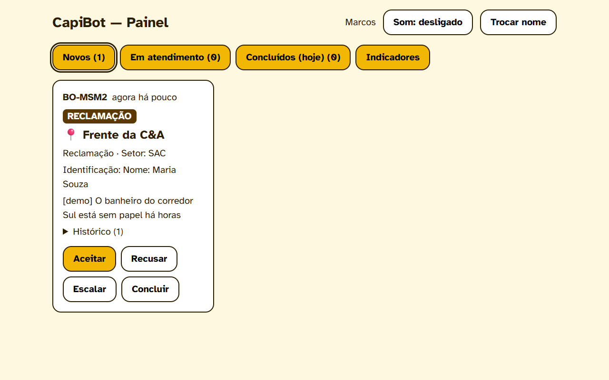

*Chamado novo: local de origem, assunto, setor, identificação, texto e ações.*

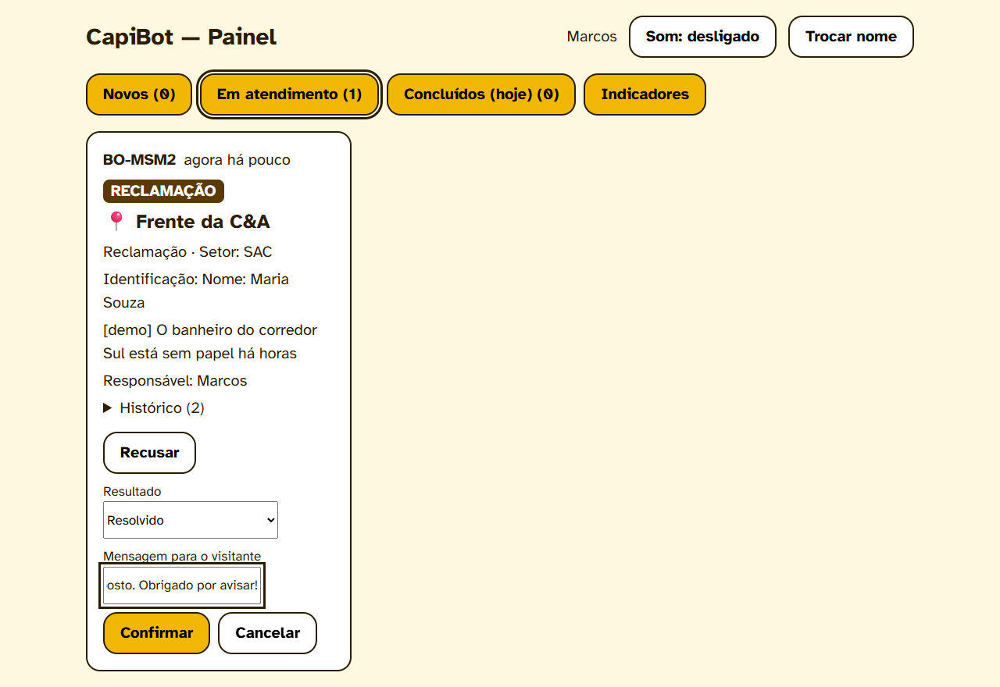

*Concluir: resultado e mensagem que o visitante verá no chat.*

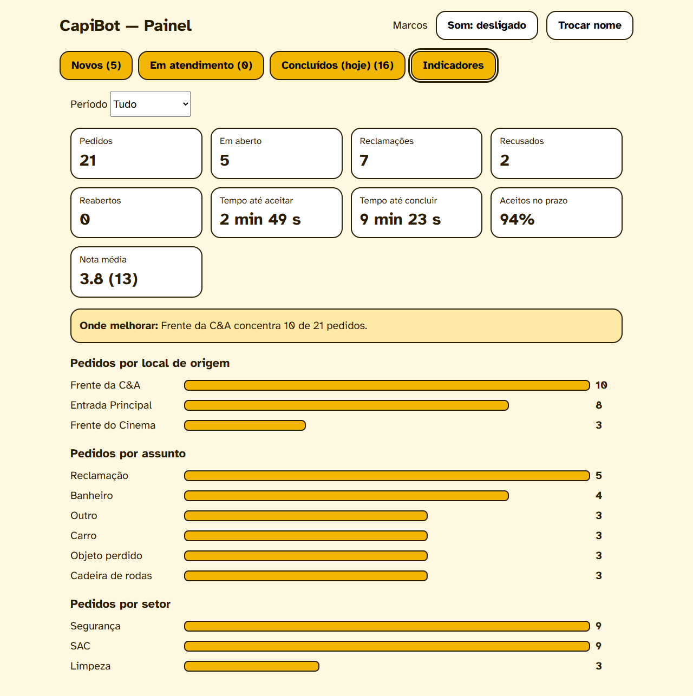

*Aba Indicadores, com dados de demonstração (`npm run seed:demo`).*

## 4. Resolução e feedback do visitante

- Concluído: mensagem com `resolutionNote` e "Deu certo?". Se `improcedente`: mensagem de recusa com o motivo, sem pergunta de satisfação.
- **Ainda não** → `reopenTicket`: volta a `novo`, prioridade `alta`, **uma vez**, até 24 h após concluir, só na mesma sessão. Registra evento `reaberto`.
- Nota 1–5 → `rateTicket` (só se concluído). Evento `avaliado`.

## 5. Dados

`003_atendimento.sql` (aditiva) acrescenta a `tickets`: `kind` (`ajuda|reclamacao|sugestao`), `team` (`seguranca|sac|manutencao|limpeza`), `contact`, `resolution_code` (`resolvido|encaminhado|nao_localizado|improcedente`), `resolution_note`, `escalated_at`, `reopened_count`, `rating`, `feedback_text`; e cria `ticket_events(id, ticket_id, at, actor, type, note)` com `criado, assumido, nota, escalado, transferido, concluido, reaberto, avaliado`.

`categorize.ts`: palavras-chave definem categoria, **prioridade** (`alta` p/ emergência e cadeira de rodas), **kind** e **setor** (carro/emergência/cadeira → segurança; banheiro → limpeza; demais → SAC).

`data/base-shopping.json` contém também `orientacoes` (carro, objeto perdido, cadeira de rodas, banheiro, emergência, reclamação). Hoje elas alimentam **somente** a seção "O que fazer se…" do `/faq`; o chat não as usa mais e elas não vão para o prompt do Gemini.

## 6. Contratos e API

`contracts.ts`: `TicketCategory` (+ `reclamacao`), `TicketKind`, `TicketTeam`, `ResolutionCode`; `TicketPublic` (+ `kind`, `resolutionNote`, `resolutionCode`, `rating`, `canReopen`); `BotMessage.ticketId` (chamado criado pela conversa; o front passa a acompanhá-lo).

| Rota | Descrição |
|---|---|
| `POST /api/session`, `POST /api/chat` | sessão e conversa (Tela 1) |
| `POST /api/tickets` | multipart: `sessionId`, `category?`, `kind?`, `text?`, `transcript?`, `contact?`, `photo?` |
| `GET /api/tickets/:id?sessionId=` | `TicketPublic` (nunca expõe contato nem notas internas; `404` se a sessão não for a da criação) |
| `POST /api/tickets/:id/feedback` | `{ sessionId, resolved, rating?, text? }`; `resolved=false` reabre |
| `GET /api/panel/tickets?status=` | lista com `pointName`, `photoUrl`, `ageSeconds`, `overdue`, `events` |
| `PATCH /api/panel/tickets/:id` | `assumir`, `concluir {resolutionCode?, note?}`, `recusar {reason}`, `nota {note}`, `escalar`, `transferir {team}` |
| `GET /api/panel/metrics?days=` | indicadores |
| `GET /api/uploads/:file` | foto do chamado |

**Removidas:** `POST /api/panel/login` e `POST /api/panel/logout` (não há autenticação).

## 7. Segurança e LGPD

- **Painel, métricas e fotos estão abertos** a quem tiver a URL. Antes de publicar (ex.: Render), restrinja por rede ou proxy: nome, telefone, texto e fotos dos chamados ficam expostos e qualquer pessoa pode aceitar, recusar ou concluir pedidos.
- O visitante só lê chamados da própria sessão. `contact` e notas internas nunca vão ao visitante.
- Fotos validadas por magic bytes; `npm run purge:uploads` apaga fotos **e o `contact`** de chamados concluídos há mais de 24 h.
- Limites: 1000 caracteres por texto, 5 MB por foto, 5 chamados por sessão por hora, 20 mensagens por minuto por sessão no chat.

## 8. Executar, testar e operar

```bash
npm install
cp .env.example .env.local     # GEMINI_API_KEY é opcional (sem chave usa o fallback local)
npm run dev                    # http://localhost:3000
npm test                       # Vitest (41 testes)
npm run validate:base          # valida base, plantas e rotas
npm run seed:demo              # 18 chamados fictícios p/ os indicadores ("-- --clear" remove)
npm run https:proxy            # https://localhost:3443 → :3000 (microfone/câmera no celular)
npm run purge:uploads          # LGPD
```

Variáveis: `GEMINI_API_KEY`, `GEMINI_MODEL`, `BASE_URL` (QR), `CAPIBOT_DB`, `UPLOADS_DIR`, `NEXT_PUBLIC_USE_MOCKS`, `NEXT_DIST_DIR` (build separado para uma 2ª instância). `PANEL_PASSWORD` e `SESSION_SECRET` **não são mais usadas**.

- **Mocks:** com `NEXT_PUBLIC_USE_MOCKS=true` o front usa `src/lib/client/mock.ts`, que **não** implementa o fluxo "localização ou reclamação". Para ver o fluxo real use `false` e reinicie o `next dev` (variáveis `NEXT_PUBLIC_` só valem após reiniciar).
- `npm run https:proxy` usa os certificados do mkcert em `certificates/` (gerados por `next dev --experimental-https`) e precisa do app já rodando.
- Pouca memória pode derrubar um 2º `next dev`; prefira uma instância só.

## 9. Testes

Vitest (`src/server/__tests__/`): categorização (kind/setor), transições de chamado, conclusão com nota, avaliação, reabertura (1×, janela, sessão), escalonamento e transferência, recusa sem vazar contato, indicadores, e o orquestrador (saudação, escolha localização/reclamação, mapas, fluxo completo de reclamação com identificação, ausência de "Falar com uma pessoa", botões ao fim do assunto).
Validado manualmente pela API (ciclo completo: orientar → criar com foto → aceitar → concluir → reabrir → recusar → avaliar → indicadores). O chat, o painel (incluindo Indicadores), `/atendimento` e `/faq` foram percorridos num navegador (Edge, janela de celular e de desktop) e as capturas estão acima. **Ainda não verificados:** um celular físico, microfone e câmera, TalkBack e Lighthouse.

## 10. Limitações conhecidas

- Reabrir um chamado zera `assumed_at`, então o "tempo até aceitar" e o "% no prazo" ignoram os reabertos.
- Um chamado recusado ainda pode ser reaberto **pela API** (a tela do chat não oferece o botão).
- Foto e voz **não** fazem parte da reclamação feita no chat (só texto); existem apenas na `/atendimento`.
- `/atendimento` e seus links no `/faq` ("Falar com uma pessoa", "Reclamações e serviços") ficaram fora da simplificação do chat.
- `nota` e `transferir` não têm botão no painel.
- `smoke-tickets.ps1` não cobre recusa, feedback nem métricas.

## 11. Definição de pronto

Pelo celular, em `/?p=entrada-principal`, o visitante escolhe um tópico, vê o mapa **ou** registra uma reclamação informando nome e texto e recebe um protocolo; a equipe vê o chamado com local e identificação em menos de 6 s, aceita ou recusa (com motivo); o chat mostra o resultado; ao concluir, o visitante confirma "deu certo?" ou reabre; e o painel mostra atrasos e indicadores por local.
